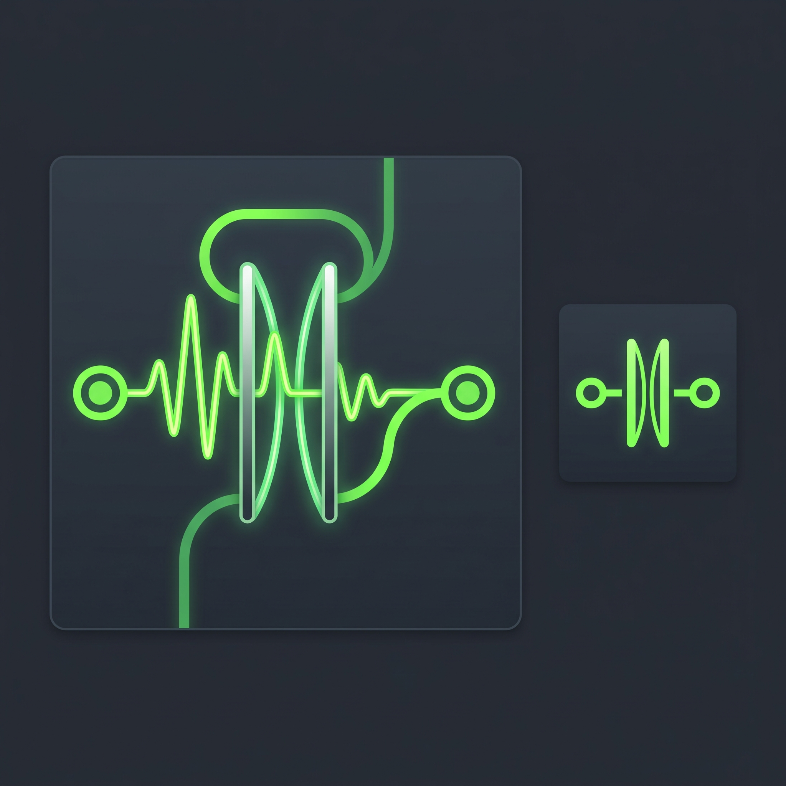

<p align="center">
  
</p>

<h1 align="center">PipeWire Audio Gate Router</h1>

<p align="center">
  A native GTK4 noise-gated patchbay for PipeWire on Linux.
</p>

<p align="center">
  <a href="LICENSE"></a>
  
  
  
</p>

---

**PipeWire Audio Gate Router** is a small C/GTK4 application that opens and closes
direct PipeWire graph links based on the level of an audio source. Instead of
routing audio through a userspace pass-through stream, it watches a source and
uses `pw-link` to wire ports together only while the signal is above a chosen
decibel threshold.

The result is a noise gate that behaves like a patchbay cable: when the source
is loud enough, the cable is plugged in; when it goes quiet for long enough, the
cable is pulled.

```
                    ┌──────────────────┐
  input source ────▶│  level detector  │──── above threshold? ────┐
                    └──────────────────┘                          │
                                                                  ▼
  input ports  ────────────── direct PipeWire link ──────────▶  output ports
                (no audio copied through this application)
```

## Features

- **Direct PipeWire graph routing** — audio flows through links created with
  `pw-link`, so the application is not in the audio path and adds no
  pass-through buffering latency.
- **Fast level detection** — monitors the source in ~5.3 ms chunks
  (256 frames at 48 kHz) and computes RMS level in dBFS.
- **Adjustable gate threshold** — per-route threshold from `-80 dB` to `0 dB`
  (default `-40 dB`).
- **Hold time** — keeps the link open for `600 ms` after the level drops below
  the threshold, preventing choppy cut-offs between words or notes.
- **Multiple independent routes** — build a patchbay table with one worker
  thread per active route, each with its own source, ports, threshold, and
  status.
- **Automatic port discovery** — enumerates sources and sinks through the
  PulseAudio API and lists available ports with `pw-link -o` / `pw-link -i`.
  Stereo shortcuts and common fallback port names are provided.
- **Live status readout** — each row shows the current level and whether the
  route is currently `LINKED` or `Unlinked`.
- **KDE / FreeDesktop system tray** — implements
  `org.kde.StatusNotifierItem` and `com.canonical.dbusmenu` over D-Bus
  directly, with no external tray library. Closing the window hides it to the
  tray.
- **Self-contained icon** — the PNG is baked into the binary at build time and
  exposed through both the icon theme and the tray's `IconPixmap` property.
- **Autostart support** — optional *Launch on login* toggle writes an XDG
  autostart entry; *Start minimized* launches without showing the window.
- **Quiet configuration** — routes and preferences are stored in
  `~/.config/audio_gate_router/routes.conf`. The file is compared and only
  rewritten when something changed, on an hourly timer and on clean exit.
- **Clean teardown** — all active links are removed on quit, system tray quit,
  `SIGINT`, or `SIGTERM`.

## Requirements

A Linux desktop running **PipeWire** with its PulseAudio compatibility layer
(`pipewire-pulse`), since the application uses the PulseAudio API to enumerate
and monitor devices while using `pw-link` to patch the graph.

Build dependencies:

- a C compiler and `make`
- GTK 4 development headers
- libpulse and libpulse-simple development headers
- `xxd` (used to bake the PNG icon into a C header)
- `pkg-config`

Runtime dependencies:

- PipeWire, including `pw-link`
- a running PipeWire-Pulse server
- a StatusNotifierItem host for the tray (KDE Plasma has native support;
  GNOME requires an AppIndicator extension)

### Install dependencies

**Fedora**

```bash
sudo dnf install gcc make pkg-config vim-common gtk4-devel \
    pulseaudio-libs-devel pipewire-utils pipewire-pulseaudio
```

**Ubuntu / Debian**

```bash
sudo apt install build-essential pkg-config xxd libgtk-4-dev libpulse-dev \
    pipewire-bin pipewire-pulse
```

**Arch Linux**

```bash
sudo pacman -S base-devel pkg-config xxd gtk4 libpulse pipewire pipewire-pulse
```

## Build

From the project directory:

```bash
make
```

This generates `app_icon_data.h` from `app_icon.png` and produces the
`audio_gate_router` executable. Run it directly:

```bash
./audio_gate_router
```

`make clean` removes the executable and the generated icon header.

## Install

Install the binary, desktop entry, and icon system-wide:

```bash
sudo make install
```

To install under a different prefix, such as your home directory:

```bash
make install PREFIX="$HOME/.local"
```

After installing or changing the icon, refresh the desktop caches if your
environment does not do it automatically. For KDE Plasma:

```bash
rm -rf ~/.cache/icon-cache.kcache
kbuildsycoca6 --noincremental
```

For GTK-based desktops:

```bash
gtk-update-icon-cache -f -t "$HOME/.local/share/icons/hicolor" 2>/dev/null || true
```

## Uninstall

```bash
sudo make uninstall
```

This removes the installed binary, desktop entry, icon, autostart entry, and
application data directory. The configuration file at
`~/.config/audio_gate_router/routes.conf` is intentionally left in place;
delete it manually if you want to reset all routes.

## Usage

1. Launch **PipeWire Audio Gate Router** from your application menu or run
   `audio_gate_router` in a terminal.
2. Click **+ Add Direct Node Link** to create a route row.
3. Choose an **Input Node** and **Input Port**. This is the source whose level
   will drive the gate.
4. Choose an **Output Node** and **Output Port**.
5. Set the **Gate (dB)** threshold. The default is `-40 dB`.
6. Turn on the **Active** switch.

The **Status** column updates with the current level:

- `Unlinked (-58.2 dB)` — the gate is closed.
- `LINKED (-24.5 dB)` — the signal crossed the threshold and the ports are
  linked in PipeWire.

The route stays linked until the level has been below the threshold for
`600 ms`, then the ports are disconnected again.

> **Changing a running route:** node, port, and threshold controls are locked
> while a route is active. Turn **Active** off, make your changes, then turn it
> back on to restart the worker with the new settings.

### Choosing the right source

The application monitors the selected input node itself. To gate based on what
is playing on an output device, select that device's monitor source (for
example, a source whose name ends in `.monitor`) as the input node.

### Port behavior

Selecting the **Stereo (FL + FR)** source port links both front channels; a
mono source can be fanned out to both output channels. Explicit port names
produce a single one-to-one link. This mirrors what you would create manually
in `qpwgraph`, `helvum`, or with `pw-link`.

## System tray

Closing the main window hides it rather than quitting. The tray icon provides:

- **Left-click** — show or hide the patchbay window.
- **Right-click** — open the menu with **Show / Hide Patchbay** and
  **Quit Completely**.

Use **Quit Completely** (or the button in the window) to remove all active
links and save the configuration before exiting.

On desktops without StatusNotifierItem support, the window still works but the
tray icon may not appear. On GNOME, install and enable an AppIndicator/KStatus
Notifier extension.

## Configuration

Settings and routes are stored at:

```text
~/.config/audio_gate_router/routes.conf
```

The file is created automatically on first launch. An example:

```ini
[General]
launch_on_login=false
start_minimized=false
route_count=1

[Route_0]
source_node=alsa_input.usb-Example_Audio_Device-00.analog-stereo
source_port=Stereo (FL + FR)
sink_node=alsa_output.usb-Example_Audio_Device-00.analog-stereo
sink_port=Stereo (FL + FR)
threshold_db=-40
active=true
```

Notes:

- Device and port names must match what PipeWire reports. Use `pw-link -o` and
  `pw-link -i`, or inspect the dropdowns in the application.
- The file is diffed against the running state every hour and on clean exit;
  it is only rewritten when the contents actually change.
- A route is only serialized when both a source and a sink are selected.
- Deleting the file resets the application to a single default route on the
  next launch.

## How it works

1. On startup the application enumerates PulseAudio sources and sinks and
   reads the available ports for each node with `pw-link`.
2. Enabling a route starts a worker thread that opens a record stream on the
   selected input node at 48 kHz, stereo, signed 16-bit.
3. The worker reads 256-frame chunks, computes RMS, and converts it to dBFS.
4. When the level is at or above the threshold, it records the activity time
   and creates the configured links with `pw-link source_port sink_port`.
5. While the activity time is within the hold window (`600 ms`), the links
   remain in place. Once it expires, the worker removes them with
   `pw-link -d`.
6. On shutdown, all workers stop and all links are explicitly removed.

The application does not create its own virtual source or sink, and it never
copies audio from input to output. It only patches existing PipeWire ports.

## Troubleshooting

**No devices in the dropdowns**

- Confirm PipeWire-Pulse is running: `pactl info` should report a server.
- Check that the devices exist in PipeWire: `pw-cli ls Node` or `wpctl status`.

**No ports listed for a node**

- Verify the node name and run `pw-link -o` (outputs) or `pw-link -i`
  (inputs) manually.
- Ports may change when a device is unplugged or a node is recreated. Restart
  the application or toggle the route off and on.

**The status shows a level but the route never links**

- Lower the threshold, or raise the source volume.
- Confirm the source actually produces signal while the route is active.
- Check that the selected input port and output port exist and are compatible.

**Nothing is audible**

- Confirm the output node and port are correct; the gate only creates links,
  it does not change volume or create sinks.
- Remember that the link is removed after `600 ms` of silence.

**The tray icon is missing**

- Your desktop needs a StatusNotifierItem host. KDE Plasma supports it
  natively; GNOME needs an extension.

**Links are left behind after a crash**

- The application removes links on clean exit, but a crash or `SIGKILL` cannot
  run cleanup. Remove stale links with `pw-link -d`, or restart PipeWire.

## Project structure

| File | Purpose |
| --- | --- |
| `audio_gate_router.c` | GTK4 UI, PulseAudio level-monitor threads, `pw-link` graph management, tray D-Bus server, and configuration sync. |
| `app_icon.h` | Decodes the baked-in PNG and builds the `a(iiay)` ARGB32 pixmap used by the tray and window icon. |
| `app_icon.png` | Source icon. Baked into a C header during the build. |
| `app_icon_data.h` | Generated by `xxd` from `app_icon.png`; not checked in. |
| `Makefile` | Build, install, uninstall, and clean targets. |
| `README.md` | This document. |

## Limitations

- The gate controls graph links, not gain. It cannot fade audio in or out; links
  are connected or disconnected.
- The monitor stream is opened on the selected source, which adds a small
  amount of client activity while a route is active.
- A crash or forced kill cannot clean up active links.
- The tray integration targets the KDE/FreeDesktop StatusNotifierItem
  specification; other tray implementations may behave differently.

## License

MIT License. See [LICENSE](LICENSE).
